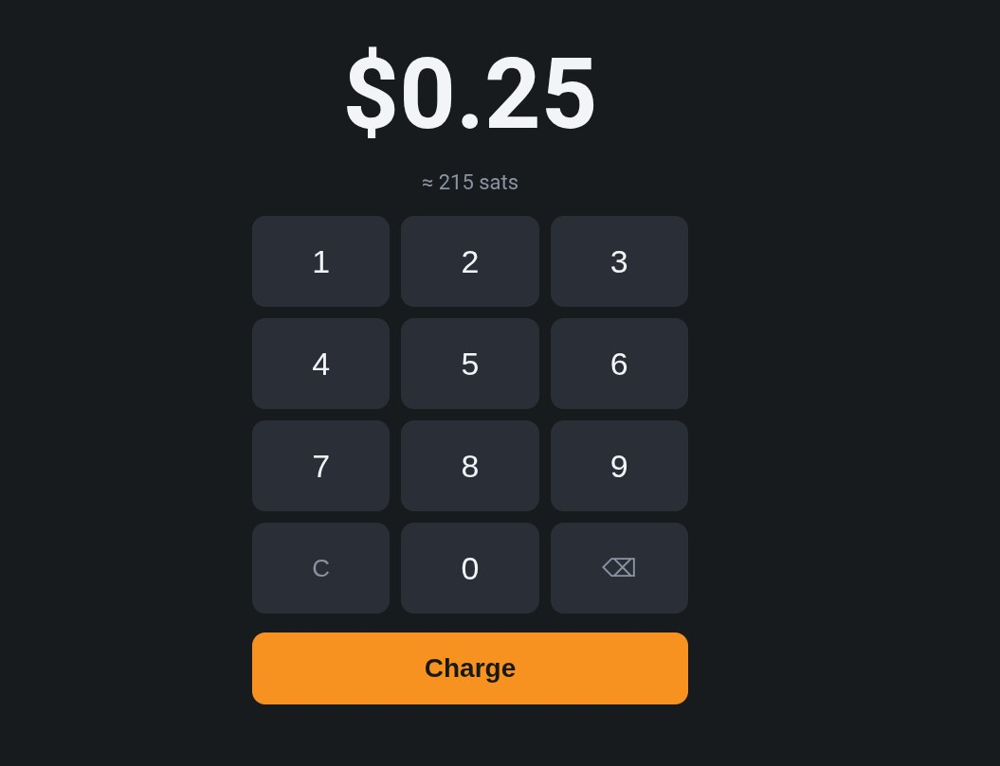
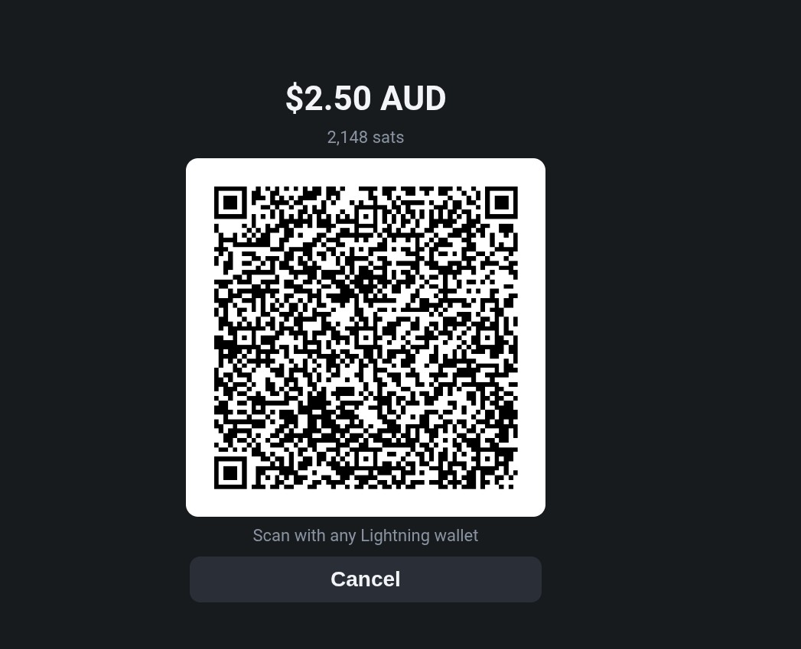

# WavePos

A tiny point-of-sale for taking Bitcoin payments at a shop counter, built on
[Wavelength](https://wavelength.lightning.engineering/), Lightning Labs' Ark
wallet.

Punch in an amount in your local currency, the customer scans a Lightning QR,
and the screen goes green when it's paid. There are no Lightning channels to
open, no inbound liquidity to manage, and no domain to buy.

<p>
  
  
</p>

> [!WARNING]
> **Beta software on top of beta software.** Wavelength mainnet is
> invite-only and still changing. Treat this as a "we also accept Bitcoin"
> option, sweep often, and don't keep more on it than you can afford to lose.

## Quick start

You need a [Wavelength](https://wavelength.lightning.engineering/) `waved`
already running on mainnet on the same machine (see
[step 1](#1-run-wavelength-on-mainnet)). Then:

```sh
# Download the binary (use wavepos-linux-arm64 on a Raspberry Pi)
curl -fLo /usr/local/bin/wavepos \
  https://github.com/hsdredgun/wavepos/releases/latest/download/wavepos-linux-amd64
chmod 755 /usr/local/bin/wavepos

# Give it a macaroon that can create invoices but never spend
wavecli bakemacaroon \
  uri:/wavewalletrpc.WalletService/Recv \
  uri:/wavewalletrpc.WalletService/Status \
  uri:/wavewalletrpc.WalletInspectionService/InspectActivity \
  --save-to /root/.waved/pos.macaroon

# Run it and open http://<this-machine>:8080 on a tablet
wavepos -listen :8080 -macaroon /root/.waved/pos.macaroon -currency AUD
```

That's enough to try it on your home network. For a real counter, read the
full setup below: systemd, the shop key, a public HTTPS address with Tailscale
Funnel, and the auto-sweep to cold storage.

## How it works

```
Tablet browser ──HTTPS──> wavepos (Go, one binary) ──REST──> waved (Wavelength daemon)
                                                                    │
       wave-sweep.timer: balance over threshold → sweep to on-chain cold storage
```

- **wavepos** serves the keypad page, converts fiat to sats (Coinbase, with
  Kraken as fallback), asks `waved` for a Lightning invoice and polls it until
  it's paid.
- Customers pay with **any Lightning wallet**. Payers who also use Wavelength
  settle directly inside Ark.
- It runs with a **receive-only macaroon**: it can create invoices and read
  their status, but it cannot spend.
- **wave-sweep** moves the balance to an on-chain address when it gets big,
  because a Wavelength wallet can only hold so much (see limits).

## Operator limits (as of Wavelength v0.1.99)

Check yours with `wavecli getinfo` → `server_info`.

| Limit | Value | What WavePos does about it |
|---|---|---|
| `max_vtxo_amount` | 50,000 sats | Bills above this are split into several equal QR payments, each 10% under the limit. The customer sees a short note explaining why. |
| `max_user_balance` | 300,000 sats | Before each invoice WavePos checks the balance. If the payment would go over, the screen asks staff to wait for the sweep. |
| `min_vtxo_amount_sat` | 1,000 sats | Smaller payments still work: they land as server credit and turn into a VTXO once credit passes 1,000. |

When the operator raises the limits, change `-max-invoice-sats` and
`-max-balance-sats`.

## Full setup

These steps assume Linux with systemd and `jq` (for the sweep script), run
as root, for example in a dedicated container or VM. Adjust the `/root/...`
paths if you run it as another user.

### 1. Run Wavelength on mainnet

Build `waved` and `wavecli` (needs Go 1.25.5+; installs both to `~/go/bin`):

```sh
git clone https://github.com/lightninglabs/wavelength && cd wavelength
make install-wavewalletrpc
```

Create a wallet password file so `waved` can unlock itself after a reboot,
then run it with the example service from this repo (adjust the path to your
`wavepos` clone):

```sh
mkdir -p /root/.waved
(umask 077; openssl rand -base64 32 > /root/.waved/mainnet-password.txt)
cp ~/wavepos/contrib/waved.service /etc/systemd/system/
systemctl daemon-reload && systemctl enable --now waved
```

Create the wallet. It prints a 24-word seed **once**: write it down on
paper. It is an aezeed (LND-style) seed, not BIP39, so it only restores in
Wavelength (`wavecli create --recover`), not in ordinary Bitcoin wallets.

```sh
wavecli create --wallet-password-file=/root/.waved/mainnet-password.txt
```

Mainnet is allowlisted. Run `wavecli getinfo` and submit your
`identity_pubkey` through the access form linked from the
[Networks & config](https://wavelength.lightning.engineering/concepts/networks-and-config/)
docs. A new seed means a new identity, so don't recreate the wallet after
you've been approved.

`waved` must stay running. It refreshes your VTXOs for free before their
batch expires (in the operator's free refresh window). If it's offline for
that whole window, the operator may sweep the expired batch.

### 2. Bake a receive-only macaroon

```sh
wavecli bakemacaroon \
  uri:/wavewalletrpc.WalletService/Recv \
  uri:/wavewalletrpc.WalletService/Status \
  uri:/wavewalletrpc.WalletInspectionService/InspectActivity \
  --save-to /root/.waved/pos.macaroon
chmod 600 /root/.waved/pos.macaroon
```

### 3. Install

Download a prebuilt binary from
[Releases](https://github.com/hsdredgun/wavepos/releases) (Linux amd64 and
arm64, checksums in `SHA256SUMS`), as in the quick start. You also want the
repo for the `contrib/` files:

```sh
git clone https://github.com/hsdredgun/wavepos && cd wavepos
```

Or build it yourself with Go 1.22+:

```sh
go build -o wavepos . && install -m 755 wavepos /usr/local/bin/wavepos
```

### 4. Shop key (optional, recommended)

If the POS is reachable from the internet, lock it with a shared key:

```sh
(umask 077; openssl rand -hex 16 > /root/.wavepos-key)
```

Open `https://<your-pos>/?k=<key>` once on the till and add it to the home
screen. Staff just tap the icon. Anyone without the key sees `Locked`.

### 5. Run it with systemd

```sh
cp contrib/wavepos.service /etc/systemd/system/
systemctl daemon-reload && systemctl enable --now wavepos
```

#### Changing settings

Settings are flags on the `ExecStart=` line of
`/etc/systemd/system/wavepos.service`. A flag you leave out uses its
default. For example, to take US dollars instead of Australian dollars,
change `-currency AUD` to `-currency USD`:

```sh
nano /etc/systemd/system/wavepos.service   # edit the ExecStart= line
systemctl daemon-reload && systemctl restart wavepos
```

To put your shop name in the invoice memo, add a line such as
`-memo "Joe's Coffee" \` the same way.

All flags:

| Flag | Default | |
|---|---|---|
| `-listen` | `127.0.0.1:8080` | Use `:8080` to also allow LAN access |
| `-macaroon` | (required) | The receive-only macaroon |
| `-currency` | `AUD` | Any code Coinbase/Kraken quote against BTC (USD, EUR, GBP…) |
| `-memo` | empty | Prefix for the invoice memo. Payers can read it, so leave it empty if you'd rather not name your shop |
| `-key-file` | empty | Shop key file; empty leaves the POS unlocked |
| `-icon` | empty | Your logo as a PNG (180×180 works best), shown in the browser tab and as the home-screen icon |
| `-max-invoice-sats` | `50000` | Operator `max_vtxo_amount` |
| `-max-balance-sats` | `300000` | Operator `max_user_balance` |
| `-waved` | `http://127.0.0.1:10031` | `waved` REST gateway |

### 6. Put it online with Tailscale Funnel

[Funnel](https://tailscale.com/kb/1223/funnel) gives you a public
`https://<machine>.<tailnet>.ts.net` address with a real certificate. You
don't need a domain or port forwarding, and the till doesn't need Tailscale
installed.

```sh
tailscale up --hostname=wavepos
tailscale funnel --bg 8080
```

A new Funnel name can take up to half an hour to show up in public DNS.

If this runs in a **Proxmox LXC container**, give it a TUN device first by
adding this to `/etc/pve/lxc/<id>.conf` on the host, then rebooting the
container:

```
lxc.cgroup2.devices.allow: c 10:200 rwm
lxc.mount.entry: /dev/net/tun dev/net/tun none bind,create=file
```

### 7. Auto-sweep to cold storage

Edit `ADDR` (and the thresholds, if you like) in `contrib/wave-sweep.sh`,
then run:

```sh
install -m 755 contrib/wave-sweep.sh /usr/local/bin/wave-sweep.sh
cp contrib/wave-sweep.service contrib/wave-sweep.timer /etc/systemd/system/
systemctl daemon-reload && systemctl enable --now wave-sweep.timer
```

Every 2 minutes it checks the confirmed balance. From 150k sats it previews a
cooperative exit and sweeps everything if the fee is under 2,000 ppm. From
250k sats it accepts up to 10,000 ppm, so the wallet never fills up. The
operator sets the exit fee; a single-VTXO exit cost about 285 sats in
testing.

The sweep uses the admin macaroon and runs separately from the POS, so the
web-facing process never holds spending rights.

## Troubleshooting

| Symptom | Cause and fix |
|---|---|
| Page says `Locked` | The link is missing `?k=<key>`. Open the full link once and re-add it to the home screen. |
| Funnel address doesn't load ("server not found") | A new Funnel name can take up to half an hour to reach public DNS. Check with `dig +short <name>.ts.net @1.1.1.1`. Once that prints an IP, toggle the tablet's Wi-Fi to clear its cached "not found". |
| `waved` won't start: `$HOME is not defined` | systemd doesn't set `HOME` for root services. Add `Environment=HOME=/root` (as in `contrib/waved.service`). |
| `waved unreachable` on the till | `waved` is down or still locked. Check `systemctl status waved`, and that `--wallet.password_file` points at the right file. |
| `No BTC/<currency> rate` | The machine can't reach Coinbase or Kraken, or neither quotes your currency code. |
| "Bill too big for the wallet right now" | The bill plus the current balance would pass `max_user_balance`. Wait a few minutes for the sweep, or lower `THRESHOLD` in `wave-sweep.sh`. |
| A small payment shows as credit, not balance | Normal below the operator's 1,000 sat VTXO floor. Credit turns into a VTXO once it passes 1,000. |
| Sweep log says `not sweeping` | The exit fee was above your ppm limit. It retries every 2 minutes; the fee in ppm drops as the balance grows. |
| After a power cut the POS stays down | The machine or container doesn't start on boot. On Proxmox: `pct set <id> --onboot 1`. Keep this on: `waved` must run to refresh your VTXOs before they expire. |

Spending from the wallet by hand with `wavecli send`: the change must be
either 0 or at least 1,000 sats, or the send fails before it starts. To
empty the wallet over Lightning, size the invoice so the `--dry-run` shows
`expected_total_outflow_sat` equal to your balance.

## License

MIT
